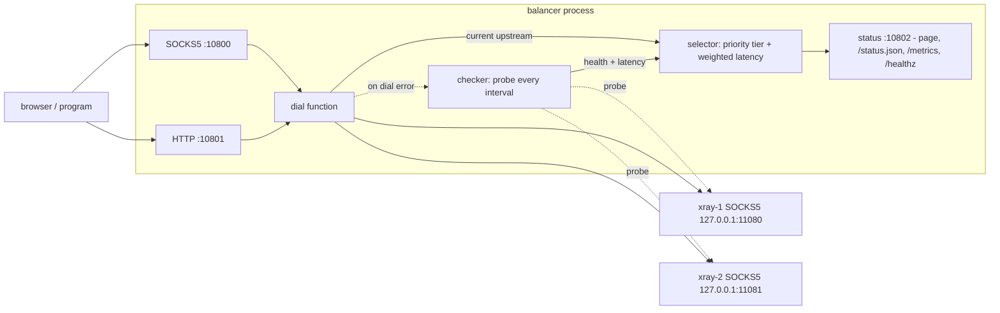

# proxy-socks5-balancer: documentation

[README](../README.md) | [Russian version](ru.md)

## Contents

1. Overview
2. Architecture
3. Configuration
4. Health-check algorithm
5. Selection strategy
6. Frontends
7. Status page and JSON
8. Signals
9. Adding an upstream
10. Running under systemd
11. Troubleshooting
12. deb/rpm packages

## 1. Overview

proxy-socks5-balancer is a Go service (Go 1.24; dependencies: `golang.org/x/net/proxy` for the SOCKS5 dialer and `gopkg.in/yaml.v3`). It health-checks several local SOCKS5 proxies (for example, provided by v2ray/xray instances) and publishes one stable SOCKS5 port and one stable HTTP-proxy port. Every connection to these ports goes through the fastest working upstream. The browser or program is configured once and never changed again: when an upstream fails or a faster one appears, the balancer switches transparently.

At any moment there is a single active upstream. Connections are not spread across several upstreams at once, there is no authentication, and there is no per-site routing.

## 2. Architecture

```
                         +--> 127.0.0.1:11080  xray-1 (SOCKS5)
browser / program        |
  --> SOCKS5 :10800 --+  |
  --> HTTP   :10801 --+--+--> 127.0.0.1:11081  xray-2 (SOCKS5)
                      |  |
        selector -----+  +--> ...
           ^
           |
        checker  (probes every upstream each `interval`)

  status :10802  -> web page, /status.json, /metrics, /healthz
```



Components:

- `cmd/balancer/main.go`: entrypoint, flag `-config` (default `config.yaml`), wiring of components, signal handling.
- `internal/config`: config loading, defaults and validation.
- `internal/upstream`: upstream model, health state, SOCKS5 dialing.
- `internal/checker`: periodic probing of upstreams.
- `internal/selector`: selection by priority tier, then min weighted latency with switch margin.
- `internal/frontend`: inbound SOCKS5 and HTTP proxy servers.
- `internal/status`: status web page, JSON endpoint, Prometheus `/metrics` and `/healthz`.
- `internal/metrics`: runtime counters exposed by `/metrics`.
- `internal/hook`: the `on_switch` command hook run when the active upstream changes.

Both frontends use the same dial function: it asks the selector for the current upstream and dials the target through that upstream's SOCKS5. If there is no active upstream, the dial fails with `no healthy upstream available`. If dialing through the active upstream fails, the checker is asked to re-check out of band (see "Passive health" in section 4).

Build and run:

```
go build -o balancer ./cmd/balancer
./balancer -config config.yaml
```

## 3. Configuration

The config is a YAML file (default `config.yaml` in the current directory, override with `-config`).

Example:

```yaml
listen:
  socks5: "127.0.0.1:10800"
  http:   "127.0.0.1:10801"
  status: "127.0.0.1:10802"
log:
  level: info
  format: text
  access: false
check:
  interval: 15s
  timeout: 5s
  required: 2
  switch_margin: 0.3
  up_threshold: 1
  down_threshold: 2
  latency_ewma: 0
  urls:
    - "https://www.google.com/generate_204"
    - "https://www.cloudflare.com/cdn-cgi/trace"
    - "https://api.github.com"
on_switch:
  command: ""
  timeout: 10s
upstreams:
  - name: xray-1
    socks5: "127.0.0.1:11080"
    priority: 0
    weight: 1
  - name: xray-2
    socks5: "127.0.0.1:11081"
    priority: 0
    weight: 1
```

### listen

| Field | Default | Meaning |
|-------|---------|---------|
| `listen.socks5` | `127.0.0.1:10800` | Address of the inbound SOCKS5 server. Point browsers and programs here. |
| `listen.http` | `127.0.0.1:10801` | Address of the inbound HTTP proxy. |
| `listen.status` | `127.0.0.1:10802` | Address of the status web page, `/status.json`, `/metrics` and `/healthz`. |

Listen addresses are read at startup. They are not changed by a config reload; to change them, restart the service.

### log

| Field | Default | Meaning |
|-------|---------|---------|
| `log.level` | `info` | Verbosity: `debug`, `info`, `warn`, `error`. `debug` logs each upstream's result every check cycle. |
| `log.format` | `text` | Output format: `text` or `json`. Logs go to stdout and include a timestamp (`time=` in text, `"time"` in json), so they are suitable for journald. |
| `log.access` | `false` | If `true`, every finished proxied connection is logged at `info` level as `msg=access` (see "Log messages" below). Can be noisy on busy hosts. |

Log level, format and `log.access` are applied at startup only; a reload does not change them.

#### Log messages

Health and switching events are logged without `debug`:

| Message | Level | Meaning |
|---------|-------|---------|
| `upstream up` | info | An upstream became healthy |
| `upstream down` | warn | An upstream was marked down; `errors` lists every failed probe URL as `url: error` |
| `upstream check failed` | warn | A check cycle failed but the upstream is not yet below `down_threshold` |
| `active upstream changed` | info | The active upstream changed; fields `from`, `to`, `from_latency_ms` and `reason` |
| `http connect dial failed`, `http forward failed` | warn | HTTP frontend errors; dial failure warnings include `client` |

`reason` is one of: `initial`, `no healthy upstream`, `pinned`, `previous down`, `better priority tier`, `faster`.

With `log.access: true` every finished connection produces one line:

```
level=INFO msg=access proto=socks5 client=127.0.0.1:32840 target=github.com:443 upstream=xray-1 sent=780 received=596236 duration_ms=3412
```

Fields: `proto` (`socks5`, `http-connect` or `http`), `client`, `target`, `upstream`, `sent` (bytes client to target), `received` (bytes target to client), `duration_ms`. Plain `http` entries have `method`, the target URL, `upstream`, `status`, `received` and `duration_ms` instead of `sent`.

### check

| Field | Default | Meaning |
|-------|---------|---------|
| `check.interval` | `15s` | Time between check cycles. |
| `check.timeout` | `5s` | Timeout of each individual check request. |
| `check.required` | `1` | Minimum number of check URLs (N of M) that must respond with HTTP status < 400 for an upstream to be healthy. |
| `check.switch_margin` | `0.3` | Fraction by which another healthy upstream must be faster than the current one to trigger a switch (0.3 = 30% faster). |
| `check.up_threshold` | `1` | Number of consecutive successful check cycles before an upstream is marked healthy. |
| `check.down_threshold` | `2` | Number of consecutive failed check cycles before a healthy upstream is marked down. This is hysteresis to avoid flapping. |
| `check.latency_ewma` | `0` | Exponential smoothing factor for the measured latency, from 0 to 1. `0` uses the raw latest sample. A value like `0.3` smooths latency over time to reduce selection flapping. Formula: `smoothed = ewma*new + (1-ewma)*old`. |
| `check.urls` | none | List of URLs fetched through each upstream. At least one is required. |

### upstreams

A list of local SOCKS5 proxies. At least one is required.

| Field | Default | Meaning |
|-------|---------|---------|
| `upstreams[].name` | none | Unique name, shown on the status page. Must not be empty. |
| `upstreams[].socks5` | none | Address of the upstream SOCKS5 proxy (`host:port`). Must not be empty. |
| `upstreams[].priority` | `0` | Integer; lower value wins. Only healthy upstreams in the best (lowest) available priority tier are used for selection; higher-number tiers act as standby/failover. |
| `upstreams[].weight` | `1` | Integer, defaults to 1; `0` is accepted and treated as 1, a negative value is rejected. A higher weight divides the measured latency for selection purposes, making the upstream look faster, so it is preferred within its tier. |

### on_switch

A command executed whenever the active upstream changes. Optional.

| Field | Default | Meaning |
|-------|---------|---------|
| `on_switch.command` | empty | Shell command run via `sh -c`. Empty disables the hook. Runs in the background as the (unprivileged) service user, so it must not require root. |
| `on_switch.timeout` | `10s` | Maximum run time; the command is killed after it. |

The event is passed as environment variables:

| Variable | Meaning |
|----------|---------|
| `BALANCER_OLD` | Previous upstream name (`none` if there was none) |
| `BALANCER_OLD_ADDR` | Previous upstream SOCKS5 address |
| `BALANCER_NEW` | New upstream name (`none` if none) |
| `BALANCER_NEW_ADDR` | New upstream SOCKS5 address |
| `BALANCER_NEW_LATENCY_MS` | New upstream latency in milliseconds |

Example:

```yaml
on_switch:
  command: 'notify-send "proxy -> $BALANCER_NEW ($BALANCER_NEW_LATENCY_MS ms)"'
  timeout: 10s
```

Note: `on_switch` is re-applied on SIGHUP reload.

### Validation

Loading fails (at startup the process exits; on reload the error is logged and the previous configuration stays in effect) if:

- there are no upstreams;
- there are no check URLs;
- `required` is greater than the number of URLs;
- an upstream name is empty;
- an upstream `socks5` address is empty;
- two upstreams have the same name;
- `check.latency_ewma` is outside 0..1;
- an upstream `weight` is negative.

## 4. Health-check algorithm

Every `interval` the checker runs one cycle. In the cycle, all upstreams are checked in parallel. For each upstream, every URL from `check.urls` is fetched through that upstream's SOCKS5 with a per-request `timeout`.

- A request counts as successful if it gets an HTTP response with status < 400, so any 2xx or 3xx code passes. Redirects are not followed: a `301`/`302` from the probe URL already proves the upstream reached the origin, and following it could land on an unrelated page (login, captive portal) and fail the check.
- The upstream passes the cycle if at least `required` of the M URLs succeeded (N of M).
- The latency of the upstream is the average latency of the successful requests. If `check.latency_ewma` is non-zero, this value is smoothed over time: `smoothed = ewma*new + (1-ewma)*old`.
- The number of successful and total requests (`ok/total`), the check time and the last error are recorded.

Example: with `required: 2` and three URLs, an upstream whose requests give 204, 200 and a timeout passes (2 of 3), and its latency is the average of the two successful requests. If only one request succeeds, it fails the cycle.

### Hysteresis

- An upstream becomes healthy after `check.up_threshold` consecutive successful cycles. With the default of 1 this gives a fast cold start: the first working upstream is usable as soon as the first cycle finishes.
- A healthy upstream is marked down only after `check.down_threshold` consecutive failed cycles (default 2). A single transient error does not take an upstream out of service (anti-flapping).

With the default `interval` of 15s and `down_threshold` of 2, a dead upstream is therefore detected within roughly two intervals, plus the request timeouts.

### Passive health

When a frontend (SOCKS5 or HTTP) fails to dial through the active upstream, the balancer triggers an out-of-band health re-check instead of waiting for the next `interval`. The trigger is rate-limited by `check.timeout` and coalesced, so a burst of failed dials causes at most one extra cycle.

A failed dial does not mark the upstream down directly. The upstream is marked down only by the normal check cycles and `down_threshold`, so a single bad target host cannot eject a healthy upstream.

## 5. Selection strategy

The strategy is priority tiers, then minimum latency with a switch margin.

- Priority: only healthy upstreams in the best (lowest) `priority` tier are considered. Upstreams in higher-number tiers are standby: they are used only when no upstream in a better tier is healthy.
- Weight: within the tier, the latency used for comparison is the measured latency divided by `weight`, so an upstream with a higher weight looks faster and is preferred.

The active upstream is the one with the lowest (weight-adjusted) latency in that tier, but to avoid flapping between proxies of similar speed, the selector switches only when:

1. the current upstream becomes unhealthy, or
2. another healthy upstream in the same tier is faster than the current one by more than `switch_margin`, or
3. a healthy upstream appears in a better (lower-number) priority tier. It preempts immediately, regardless of `switch_margin`; the margin applies only when choosing among upstreams within the same tier.

If no upstream is healthy, there is no active upstream and new connections fail with `no healthy upstream available`.

### Numeric example

`switch_margin: 0.3`, current active upstream `xray-1`.

| xray-1 latency | xray-2 latency | Result |
|----------------|----------------|--------|
| 200 ms | 170 ms | stay on xray-1 (xray-2 is 15% faster, below 30%) |
| 200 ms | 150 ms | stay on xray-1 (25% faster, below 30%) |
| 200 ms | 120 ms | switch to xray-2 (40% faster, above 30%) |
| 200 ms, unhealthy | 400 ms | switch to xray-2 (current is unhealthy, no margin needed) |

"X% faster" is computed as `(current - candidate) / current`. For example, `(200 - 120) / 200 = 0.4`.

A lower `switch_margin` makes the balancer follow the fastest upstream more eagerly; a higher one makes it stickier.

Smoothing the measured latency with `check.latency_ewma` (for example `0.3`) also reduces switching caused by short latency spikes.

## 6. Frontends

Both frontends forward every connection through the currently selected upstream's SOCKS5. Neither requires authentication, so keep them bound to a loopback address unless you understand the consequences.

### SOCKS5 (`listen.socks5`)

A minimal inbound SOCKS5 server: no authentication, CONNECT command only.

### HTTP proxy (`listen.http`)

- `CONNECT` is supported for tunneling HTTPS.
- Plain HTTP requests are forwarded.
- If the upstream cannot be reached, the client receives HTTP 502 (Bad Gateway).

## 7. Status page and JSON

`http://<listen.status>/` (by default http://127.0.0.1:10802) is an HTML page that refreshes itself every 5 seconds. It shows the SOCKS5 and HTTP addresses, the total speed (down/up) of relayed traffic and a table with, for each upstream:

| Column | Meaning |
|--------|---------|
| Active | Badge on the upstream currently used for all connections |
| Name | Upstream name |
| Address | Upstream SOCKS5 address |
| Prio/Wt | Upstream `priority` and `weight` |
| Health | up or down |
| Latency | Average latency of successful requests, `-` if not measured |
| OK/Total | Successful requests out of all check URLs in the last cycle |
| Speed | Current rate down/up (bytes per second, sampled every 2 s) and total bytes received/sent through the upstream; health-check probes are not counted. Counters reset on SIGHUP reload (upstreams are rebuilt) and on restart |
| Checked | Time since the last check, `never` if not checked yet; the last error, if any, is shown under this value |
| Control | "Switch here" button to pin this upstream as active (manual override); shows "pinned" for the currently pinned one |

The "Switch here" button pins the active upstream to the chosen proxy (manual override) and disables automatic latency-based selection. While an upstream is pinned, a banner with a "Back to auto" button appears at the top of the page; it clears the pin and restores automatic selection. The pin is stored by upstream name, so it survives a configuration reload (SIGHUP). If the pinned upstream becomes unhealthy, traffic temporarily falls back to the best healthy upstream, and the pin resumes automatically when the pinned upstream recovers. If the pinned upstream is removed from the configuration on reload, the pin is cleared. A manual switch fires the `on_switch` hook and increments the switch metrics, the same as an automatic switch.

The buttons use two POST endpoints on the status server: `POST /pin` with the form field `name` pins the upstream with that name, and `POST /auto` clears the pin. They are POST so that the 5-second page auto-refresh cannot trigger them.

`http://<listen.status>/status.json` returns the same data as a JSON array, one object per upstream:

```json
[
  {
    "Name": "xray-1",
    "Addr": "127.0.0.1:11080",
    "Priority": 0,
    "Weight": 1,
    "Healthy": true,
    "Latency": 143000000,
    "OK": 3,
    "Total": 3,
    "LastErr": "",
    "CheckedAt": "2025-01-01T12:00:00.123456789+03:00",
    "CheckTotal": 120,
    "CheckFailures": 2,
    "Active": true,
    "RxBytes": 596236,
    "TxBytes": 780,
    "RxRate": 1048576,
    "TxRate": 2048
  }
]
```

| Field | Type | Meaning |
|-------|------|---------|
| `Name` | string | Upstream name |
| `Addr` | string | Upstream SOCKS5 address |
| `Priority` | number | Configured `priority` |
| `Weight` | number | Configured `weight` |
| `Healthy` | bool | Current health state (after hysteresis) |
| `Latency` | number | Average latency in nanoseconds (Go `time.Duration`); 143000000 is 143 ms |
| `OK` | number | Successful check requests in the last cycle |
| `Total` | number | Total check requests in the last cycle |
| `LastErr` | string | Last error text, empty if none |
| `CheckedAt` | string | Time of the last check (RFC 3339); a zero time means never checked |
| `CheckTotal` | number | Total check cycles run for the upstream |
| `CheckFailures` | number | Total failed check cycles for the upstream |
| `Active` | bool | True for the upstream currently in use |
| `RxBytes` | number | Bytes relayed target to client through the upstream (health probes excluded) |
| `TxBytes` | number | Bytes relayed client to target through the upstream |
| `RxRate` | number | Current download rate in bytes per second (sampled every 2 s) |
| `TxRate` | number | Current upload rate in bytes per second |

Quick query:

```
curl -s http://127.0.0.1:10802/status.json
```

### /metrics

`GET http://<listen.status>/metrics` returns metrics in the Prometheus text format.

| Metric | Type | Labels | Meaning |
|--------|------|--------|---------|
| `balancer_switches_total` | counter | none | Active upstream changes |
| `balancer_frontend_dial_errors_total` | counter | none | Failed dials to the active upstream (both frontends); also incremented on plain-HTTP RoundTrip errors, not only on dial failures |
| `balancer_frontend_connections_total` | counter | `frontend` (`socks5`, `http`) | `socks5`: accepted connections; `http`: HTTP requests (incremented per request, so keep-alive connections inflate it) |
| `balancer_frontend_active_connections` | gauge | `frontend` (`socks5`, `http`) | Open frontend connections |
| `balancer_upstream_up` | gauge | `name` | 1 if the upstream is healthy, 0 if down |
| `balancer_upstream_latency_ms` | gauge | `name` | Last measured latency in milliseconds |
| `balancer_upstream_checks_total` | counter | `name` | Total check cycles run for the upstream |
| `balancer_upstream_check_failures_total` | counter | `name` | Total failed check cycles for the upstream |
| `balancer_active_upstream` | gauge | `name` | 1 for the currently active upstream, 0 otherwise |
| `balancer_upstream_bytes_total` | counter | `name`, `direction` (`rx`, `tx`) | Bytes relayed through the upstream: `rx` target to client, `tx` client to target; health probes not counted; resets on reload and restart |

Example Prometheus scrape config:

```yaml
scrape_configs:
  - job_name: proxy-socks5-balancer
    static_configs:
      - targets: ["127.0.0.1:10802"]
```

### /healthz

`GET http://<listen.status>/healthz` returns HTTP 200 with a body starting with `ok` (it also reports the number of healthy upstreams) when at least one upstream is healthy, and HTTP 503 otherwise. Use it for load balancers, systemd or monitoring checks:

```
curl -fs http://127.0.0.1:10802/healthz
```

## 8. Signals

| Signal | Action |
|--------|--------|
| `SIGHUP` | Reload the config file. Upstreams, `switch_margin`, check settings (`interval`, `timeout`, `required`, `urls`, `up_threshold`, `down_threshold`, `latency_ewma`) and the `on_switch` hook are swapped live; the listeners are not restarted and listen addresses are not changed. Because upstreams are rebuilt, all of them start as unhealthy and the active selection is dropped; the balancer re-probes on the next check cycle, so for up to one `interval` new connections may fail with `no healthy upstream available`. If the new config is invalid, the error is logged and the current configuration stays. |
| `SIGINT`, `SIGTERM` | Graceful shutdown. |

```
kill -HUP <pid>
```

Under systemd: `systemctl reload proxy-socks5-balancer`.

## 9. Adding an upstream

1. Start another local SOCKS5 proxy (for example, another xray instance on `127.0.0.1:11082`).
2. Add it to the config:

   ```yaml
   upstreams:
     - name: xray-1
       socks5: "127.0.0.1:11080"
     - name: xray-2
       socks5: "127.0.0.1:11081"
     - name: xray-3
       socks5: "127.0.0.1:11082"
   ```

3. Send `SIGHUP` to the balancer: `kill -HUP <pid>`.
4. Check the status page: the new upstream appears in the table. On SIGHUP all upstreams are rebuilt as unhealthy, so for up to one `interval` new connections may fail with `no healthy upstream available` until the next check cycle; each upstream becomes healthy after its first successful check cycle.

Names must be unique. Removing an upstream works the same way: edit the config and send `SIGHUP`.

## 10. Running under systemd

A unit file is provided at `deploy/proxy-socks5-balancer.service`. It expects:

- binary: `/usr/bin/proxy-socks5-balancer`;
- config: `/etc/proxy-socks5-balancer/config.yaml`;
- a non-root user and group `proxy-balancer`.

Example setup:

```
sudo useradd --system --no-create-home --shell /usr/sbin/nologin proxy-balancer
sudo install -m 0755 balancer /usr/bin/proxy-socks5-balancer
sudo install -d /etc/proxy-socks5-balancer
sudo install -m 0644 config.yaml /etc/proxy-socks5-balancer/config.yaml
sudo install -m 0644 deploy/proxy-socks5-balancer.service /etc/systemd/system/
sudo systemctl daemon-reload
sudo systemctl enable --now proxy-socks5-balancer
```

## 11. Troubleshooting

### Connections fail with "no healthy upstream available"

No upstream is currently healthy, so there is no active upstream. Open the status page and check:

- Are the upstreams listed as down? Read the last error of each.
- Are the upstream SOCKS5 proxies (xray/v2ray) actually running and listening on the configured addresses?
- Can the upstream reach the check URLs? Try manually, for example:
  `curl -x socks5h://127.0.0.1:11080 https://www.google.com/generate_204`
- Is `check.required` too strict? With `required: 3` all three URLs must succeed; one blocked URL fails the upstream. Lower `required` or change `check.urls`.
- Is `check.timeout` too small for a slow upstream? Increase it.

### All upstreams are down at startup

The first cycle runs right after start. An upstream becomes healthy after the first successful cycle, so a short delay is normal. If it persists, see the previous section. Remember that with the defaults a down mark needs 2 consecutive failed cycles (`down_threshold`), but an up mark needs only one (`up_threshold`).

### The active upstream does not change to a faster one

This is expected when the faster one is not faster by more than `switch_margin`. See the numeric example in section 5. Lower `switch_margin` and send `SIGHUP` if you want more eager switching.

### The active upstream flaps

Increase `switch_margin` or `check.interval`, or add more `check.urls` and increase `required` so that single slow responses matter less. Setting `check.latency_ewma` (for example `0.3`) smooths latency, and a higher `check.down_threshold` makes the health state less sensitive to single failed cycles.

### Reload does not apply

Check the service log for `reload failed:`. The config failed validation, and the previous configuration is still in use. Changes to `listen` addresses are never applied by reload; restart the service.

### Startup error

The process exits on config errors and when a listener cannot start (for example, the port is already in use). Check the log message.

### How to read the status page

- The row with the `active` badge is the upstream carrying all traffic.
- Prio/Wt shows `priority/weight`; an upstream in a higher-number tier is standby while a better tier has a healthy upstream.
- Health `down` with a last error explains why the upstream failed its cycles.
- `OK/Total` of `1/3` with `required: 2` means the upstream failed the cycle.
- Latency of `-` means no successful measurement yet.
- Checked shows how long ago the last cycle for that upstream completed; it should stay within about one `interval`.

## 12. deb/rpm packages

Both packages are built from a single `nfpm.yaml` description with [nfpm](https://nfpm.goreleaser.com/) running in Docker, so nothing needs to be installed on the host.

Build:

```sh
git tag -a v0.1.0 -m "release 0.1.0"
deploy/build-packages.sh
```

The version is taken from the git tag via `git describe --tags`; set
`VERSION=1.2.3` to override it. The script builds the binary (`CGO_ENABLED=0`, from the local module cache) into `dist/`, stamps the version into it (`-ldflags -X .../version.Version`), then runs nfpm twice and produces:

- `dist/proxy-socks5-balancer_0.1.0_amd64.deb`
- `dist/proxy-socks5-balancer-0.1.0-1.x86_64.rpm`

Package layout:

| Path | Purpose |
|------|---------|
| `/usr/bin/proxy-socks5-balancer` | binary |
| `/etc/proxy-socks5-balancer/config.yaml` | config (marked `config|noreplace`, kept on upgrade) |
| `/usr/lib/systemd/system/proxy-socks5-balancer.service` | systemd unit |
| `/usr/share/doc/proxy-socks5-balancer/` | README and documentation |

Maintainer scripts (`deploy/scripts/`):

- `postinstall` - creates the `proxy-balancer` system user and runs `systemctl daemon-reload`;
- `preremove` - stops the service before removal;
- `postremove` - runs `systemctl daemon-reload` after removal.

Install:

```sh
sudo apt install ./dist/proxy-socks5-balancer_0.1.0_amd64.deb     # Debian/Ubuntu
sudo dnf install ./dist/proxy-socks5-balancer-0.1.0-1.x86_64.rpm   # RHEL/Fedora

sudoedit /etc/proxy-socks5-balancer/config.yaml
sudo systemctl enable --now proxy-socks5-balancer
```
