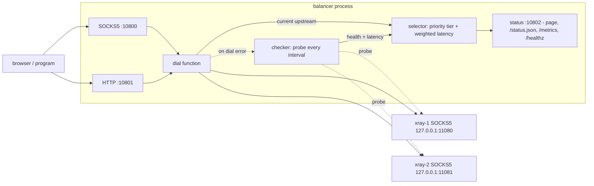

# proxy-socks5-balancer: документация

[README](../README.md) | [English version](en.md)

## Содержание

1. Обзор
2. Архитектура
3. Конфигурация
4. Алгоритм проверки здоровья
5. Стратегия выбора
6. Фронтенды
7. Страница статуса и JSON
8. Сигналы
9. Добавление апстрима
10. Запуск под systemd
11. Диагностика проблем
12. Пакеты deb/rpm

## 1. Обзор

proxy-socks5-balancer - сервис на Go (Go 1.24; зависимости: `golang.org/x/net/proxy` для SOCKS5-диалера и `gopkg.in/yaml.v3`). Он проверяет здоровье нескольких локальных SOCKS5-прокси (например, поднятых экземплярами v2ray/xray) и публикует один стабильный SOCKS5-порт и один стабильный порт HTTP-прокси. Каждое соединение с этими портами идёт через самый быстрый из работающих апстримов. Браузер или программу достаточно настроить один раз и больше не трогать: когда апстрим отказывает или появляется более быстрый, балансировщик переключается прозрачно.

В каждый момент времени есть один активный апстрим. Соединения не распределяются между несколькими апстримами одновременно, аутентификации нет, маршрутизации по сайтам нет.

## 2. Архитектура

```
                         +--> 127.0.0.1:11080  xray-1 (SOCKS5)
браузер / программа      |
  --> SOCKS5 :10800 --+  |
  --> HTTP   :10801 --+--+--> 127.0.0.1:11081  xray-2 (SOCKS5)
                      |  |
        selector -----+  +--> ...
           ^
           |
        checker  (проверяет каждый апстрим раз в `interval`)

  status :10802  -> веб-страница, /status.json, /metrics, /healthz
```



Компоненты:

- `cmd/balancer/main.go`: точка входа, флаг `-config` (по умолчанию `config.yaml`), связывание компонентов, обработка сигналов.
- `internal/config`: загрузка конфигурации, значения по умолчанию и валидация.
- `internal/upstream`: модель апстрима, состояние здоровья, SOCKS5-соединения.
- `internal/checker`: периодические проверки апстримов.
- `internal/selector`: выбор по уровню приоритета, затем по минимальной взвешенной задержке с порогом переключения.
- `internal/frontend`: входящие SOCKS5- и HTTP-прокси серверы.
- `internal/status`: веб-страница статуса, JSON-эндпоинт, Prometheus `/metrics` и `/healthz`.
- `internal/metrics`: счётчики работы, отдаваемые через `/metrics`.
- `internal/hook`: хук-команда `on_switch`, запускаемая при смене активного апстрима.

Оба фронтенда используют одну и ту же функцию соединения: она запрашивает у селектора текущий апстрим и соединяется с целью через SOCKS5 этого апстрима. Если активного апстрима нет, соединение завершается ошибкой `no healthy upstream available`. Если соединение через активный апстрим не удалось, чекеру отправляется запрос на внеочередную проверку (см. "Пассивная проверка здоровья" в разделе 4).

Сборка и запуск:

```
go build -o balancer ./cmd/balancer
./balancer -config config.yaml
```

## 3. Конфигурация

Конфигурация - YAML-файл (по умолчанию `config.yaml` в текущем каталоге, путь задаётся флагом `-config`).

Пример:

```yaml
listen:
  socks5: "127.0.0.1:10800"
  http:   "127.0.0.1:10801"
  status: "127.0.0.1:10802"
log:
  level: info
  format: text
check:
  interval: 15s
  timeout: 5s
  required: 2
  switch_margin: 0.3
  up_threshold: 1
  down_threshold: 2
  latency_ewma: 0
  urls:
    - "https://www.google.com/generate_204"
    - "https://www.cloudflare.com/cdn-cgi/trace"
    - "https://api.github.com"
on_switch:
  command: ""
  timeout: 10s
upstreams:
  - name: xray-1
    socks5: "127.0.0.1:11080"
    priority: 0
    weight: 1
  - name: xray-2
    socks5: "127.0.0.1:11081"
    priority: 0
    weight: 1
```

### listen

| Поле | По умолчанию | Назначение |
|------|--------------|------------|
| `listen.socks5` | `127.0.0.1:10800` | Адрес входящего SOCKS5-сервера. Сюда направляются браузеры и программы. |
| `listen.http` | `127.0.0.1:10801` | Адрес входящего HTTP-прокси. |
| `listen.status` | `127.0.0.1:10802` | Адрес веб-страницы статуса, `/status.json`, `/metrics` и `/healthz`. |

Адреса прослушивания читаются при запуске. Перезагрузка конфигурации их не меняет; чтобы изменить, перезапустите сервис.

### log

| Поле | По умолчанию | Назначение |
|------|--------------|------------|
| `log.level` | `info` | Детализация: `debug`, `info`, `warn`, `error`. `debug` логирует результат каждого апстрима в каждом цикле проверки. |
| `log.format` | `text` | Формат вывода: `text` или `json`. Логи пишутся в stdout и содержат метку времени (`time=` в text, `"time"` в json), поэтому подходят для journald. |

Уровень и формат логирования применяются только при старте; перезагрузка их не меняет.

### check

| Поле | По умолчанию | Назначение |
|------|--------------|------------|
| `check.interval` | `15s` | Интервал между циклами проверки. |
| `check.timeout` | `5s` | Таймаут каждого отдельного проверочного запроса. |
| `check.required` | `1` | Минимальное число URL (N из M), которые должны ответить со статусом HTTP < 400, чтобы апстрим считался здоровым. |
| `check.switch_margin` | `0.3` | Доля, на которую другой здоровый апстрим должен быть быстрее текущего, чтобы вызвать переключение (0.3 = на 30% быстрее). |
| `check.up_threshold` | `1` | Число успешных циклов проверки подряд, после которого апстрим помечается здоровым. |
| `check.down_threshold` | `2` | Число неудачных циклов проверки подряд, после которого здоровый апстрим помечается недоступным. Это гистерезис для защиты от дребезга. |
| `check.latency_ewma` | `0` | Коэффициент экспоненциального сглаживания измеренной задержки, от 0 до 1. `0` - использовать последний сырой замер. Значение вроде `0.3` сглаживает задержку во времени и уменьшает дребезг выбора. Формула: `smoothed = ewma*new + (1-ewma)*old`. |
| `check.urls` | нет | Список URL, которые запрашиваются через каждый апстрим. Нужен минимум один. |

### upstreams

Список локальных SOCKS5-прокси. Нужен минимум один.

| Поле | По умолчанию | Назначение |
|------|--------------|------------|
| `upstreams[].name` | нет | Уникальное имя, отображается на странице статуса. Не должно быть пустым. |
| `upstreams[].socks5` | нет | Адрес SOCKS5-прокси апстрима (`host:port`). Не должен быть пустым. |
| `upstreams[].priority` | `0` | Целое число; меньшее значение выигрывает. Для выбора используются только здоровые апстримы из лучшего (с наименьшим номером) доступного уровня приоритета; уровни с большим номером работают как резерв (standby/failover). |
| `upstreams[].weight` | `1` | Целое число, по умолчанию 1; `0` допустим и считается как 1, отрицательное значение отклоняется. Больший вес делит измеренную задержку при выборе, из-за чего апстрим выглядит быстрее и получает предпочтение внутри своего уровня. |

### on_switch

Команда, выполняемая при каждой смене активного апстрима. Необязательна.

| Поле | По умолчанию | Назначение |
|------|--------------|------------|
| `on_switch.command` | пусто | Команда, запускаемая через `sh -c`. Пустое значение отключает хук. Выполняется в фоне от имени (непривилегированного) пользователя сервиса, поэтому не должна требовать root. |
| `on_switch.timeout` | `10s` | Максимальное время работы; по истечении команда убивается. |

Событие передаётся в виде переменных окружения:

| Переменная | Значение |
|------------|----------|
| `BALANCER_OLD` | Имя предыдущего апстрима (`none`, если его не было) |
| `BALANCER_OLD_ADDR` | SOCKS5-адрес предыдущего апстрима |
| `BALANCER_NEW` | Имя нового апстрима (`none`, если нет) |
| `BALANCER_NEW_ADDR` | SOCKS5-адрес нового апстрима |
| `BALANCER_NEW_LATENCY_MS` | Задержка нового апстрима в миллисекундах |

Пример:

```yaml
on_switch:
  command: 'notify-send "proxy -> $BALANCER_NEW ($BALANCER_NEW_LATENCY_MS ms)"'
  timeout: 10s
```

Примечание: `on_switch` повторно применяется при перезагрузке по SIGHUP.

### Валидация

Загрузка завершается ошибкой (при запуске процесс завершается; при перезагрузке ошибка пишется в лог, а прежняя конфигурация остаётся в силе), если:

- нет ни одного апстрима;
- нет ни одного URL для проверки;
- `required` больше числа URL;
- имя апстрима пустое;
- адрес `socks5` апстрима пустой;
- у двух апстримов одинаковое имя;
- `check.latency_ewma` вне диапазона 0..1;
- `weight` апстрима отрицательный.

## 4. Алгоритм проверки здоровья

Каждые `interval` чекер выполняет один цикл. В цикле все апстримы проверяются параллельно. Для каждого апстрима каждый URL из `check.urls` запрашивается через SOCKS5 этого апстрима с таймаутом `timeout` на запрос.

- Запрос считается успешным, если получен HTTP-ответ со статусом < 400, то есть подходит любой код 2xx или 3xx. Редиректы не выполняются: ответ `301`/`302` от проверочного URL уже доказывает, что апстрим достучался до источника, а переход по нему мог бы привести на постороннюю страницу (логин, captive portal) и провалить проверку.
- Апстрим проходит цикл, если успешными оказались не менее `required` из M URL (N из M).
- Задержка апстрима - средняя задержка успешных запросов. Если `check.latency_ewma` не равен нулю, это значение сглаживается во времени: `smoothed = ewma*new + (1-ewma)*old`.
- Фиксируются число успешных и всех запросов (`ok/total`), время проверки и последняя ошибка.

Пример: при `required: 2` и трёх URL апстрим, запросы которого дали 204, 200 и таймаут, цикл проходит (2 из 3), а его задержка - среднее двух успешных запросов. Если успешен только один запрос, цикл не пройден.

### Гистерезис

- Апстрим становится здоровым после `check.up_threshold` успешных циклов подряд. При значении по умолчанию 1 это даёт быстрый холодный старт: первый работающий апстрим можно использовать, как только завершится первый цикл.
- Здоровый апстрим помечается как недоступный только после `check.down_threshold` неудачных циклов подряд (по умолчанию 2). Одиночная временная ошибка не выводит апстрим из работы (защита от дребезга).

При `interval` по умолчанию 15s и `down_threshold` равном 2 неработающий апстрим, таким образом, обнаруживается примерно за два интервала плюс таймауты запросов.

### Пассивная проверка здоровья

Когда фронтенд (SOCKS5 или HTTP) не может соединиться через активный апстрим, балансировщик запускает внеочередную проверку здоровья, не дожидаясь следующего `interval`. Запуск ограничен по частоте значением `check.timeout` и объединяется (coalesce), поэтому серия неудачных соединений вызывает не более одного дополнительного цикла.

Неудачное соединение само по себе не помечает апстрим недоступным. Апстрим становится недоступным только по результатам обычных циклов проверки и `down_threshold`, поэтому один плохой целевой хост не может вывести из работы здоровый апстрим.

## 5. Стратегия выбора

Стратегия - уровни приоритета, затем минимальная задержка с порогом переключения.

- Приоритет: учитываются только здоровые апстримы из лучшего (с наименьшим значением) уровня `priority`. Апстримы с большим номером уровня - резерв: они используются, только когда в лучших уровнях нет здоровых апстримов.
- Вес: внутри уровня для сравнения используется измеренная задержка, делённая на `weight`, поэтому апстрим с большим весом выглядит быстрее и получает предпочтение.

Активный апстрим - тот, у которого в этом уровне наименьшая (с учётом веса) задержка, но чтобы не дёргаться между прокси с похожей скоростью, селектор переключается только когда:

1. текущий апстрим стал нездоровым, или
2. другой здоровый апстрим из того же уровня быстрее текущего более чем на `switch_margin`, или
3. появился здоровый апстрим в лучшем (с меньшим номером) уровне приоритета. Он вытесняет текущий сразу, независимо от `switch_margin`; порог применяется только при выборе среди апстримов одного уровня.

Если здоровых апстримов нет, активного апстрима нет, и новые соединения завершаются ошибкой `no healthy upstream available`.

### Числовой пример

`switch_margin: 0.3`, текущий активный апстрим `xray-1`.

| Задержка xray-1 | Задержка xray-2 | Результат |
|-----------------|-----------------|-----------|
| 200 мс | 170 мс | остаёмся на xray-1 (xray-2 быстрее на 15%, меньше 30%) |
| 200 мс | 150 мс | остаёмся на xray-1 (быстрее на 25%, меньше 30%) |
| 200 мс | 120 мс | переключаемся на xray-2 (быстрее на 40%, больше 30%) |
| 200 мс, нездоров | 400 мс | переключаемся на xray-2 (текущий нездоров, порог не нужен) |

"На X% быстрее" считается как `(текущая - кандидат) / текущая`. Например, `(200 - 120) / 200 = 0.4`.

Меньший `switch_margin` заставляет балансировщик охотнее следовать за самым быстрым апстримом; больший - делает выбор более устойчивым.

Сглаживание измеренной задержки через `check.latency_ewma` (например, `0.3`) также уменьшает переключения из-за коротких скачков задержки.

## 6. Фронтенды

Оба фронтенда пересылают каждое соединение через SOCKS5 текущего выбранного апстрима. Ни один не требует аутентификации, поэтому держите их на loopback-адресе, если не понимаете последствий.

### SOCKS5 (`listen.socks5`)

Минимальный входящий SOCKS5-сервер: без аутентификации, только команда CONNECT.

### HTTP-прокси (`listen.http`)

- `CONNECT` поддерживается для туннелирования HTTPS.
- Обычные HTTP-запросы пересылаются.
- Если апстрим недоступен, клиент получает HTTP 502 (Bad Gateway).

## 7. Страница статуса и JSON

`http://<listen.status>/` (по умолчанию http://127.0.0.1:10802) - HTML-страница, обновляющаяся сама каждые 5 секунд. Она показывает адреса SOCKS5 и HTTP и таблицу, в которой для каждого апстрима указано:

| Колонка | Значение |
|---------|----------|
| Active | Метка у апстрима, через который сейчас идут все соединения |
| Name | Имя апстрима |
| Address | SOCKS5-адрес апстрима |
| Prio/Wt | `priority` и `weight` апстрима |
| Health | up или down |
| Latency | Средняя задержка успешных запросов, `-` если не измерена |
| OK/Total | Успешные запросы из всех проверочных URL в последнем цикле |
| Checked | Время с последней проверки, `never` если ещё не проверялся; последняя ошибка, если есть, показана под этим значением |

`http://<listen.status>/status.json` возвращает те же данные в виде JSON-массива, по одному объекту на апстрим:

```json
[
  {
    "Name": "xray-1",
    "Addr": "127.0.0.1:11080",
    "Priority": 0,
    "Weight": 1,
    "Healthy": true,
    "Latency": 143000000,
    "OK": 3,
    "Total": 3,
    "LastErr": "",
    "CheckedAt": "2025-01-01T12:00:00.123456789+03:00",
    "CheckTotal": 120,
    "CheckFailures": 2,
    "Active": true
  }
]
```

| Поле | Тип | Значение |
|------|-----|----------|
| `Name` | string | Имя апстрима |
| `Addr` | string | SOCKS5-адрес апстрима |
| `Priority` | number | Настроенный `priority` |
| `Weight` | number | Настроенный `weight` |
| `Healthy` | bool | Текущее состояние здоровья (с учётом гистерезиса) |
| `Latency` | number | Средняя задержка в наносекундах (`time.Duration` в Go); 143000000 - это 143 мс |
| `OK` | number | Успешные проверочные запросы в последнем цикле |
| `Total` | number | Всего проверочных запросов в последнем цикле |
| `LastErr` | string | Текст последней ошибки, пусто если ошибок нет |
| `CheckedAt` | string | Время последней проверки (RFC 3339); нулевое время означает, что проверки не было |
| `CheckTotal` | number | Всего циклов проверки, выполненных для апстрима |
| `CheckFailures` | number | Всего неудачных циклов проверки апстрима |
| `Active` | bool | True у апстрима, который используется сейчас |

Быстрый запрос:

```
curl -s http://127.0.0.1:10802/status.json
```

### /metrics

`GET http://<listen.status>/metrics` возвращает метрики в текстовом формате Prometheus.

| Метрика | Тип | Метки | Значение |
|---------|-----|-------|----------|
| `balancer_switches_total` | counter | нет | Смены активного апстрима |
| `balancer_frontend_dial_errors_total` | counter | нет | Неудачные соединения через активный апстрим (оба фронтенда); также увеличивается при ошибках RoundTrip для обычного HTTP, а не только при ошибках соединения |
| `balancer_frontend_connections_total` | counter | `frontend` (`socks5`, `http`) | `socks5`: принятые соединения; `http`: HTTP-запросы (увеличивается на каждый запрос, поэтому keep-alive-соединения завышают значение) |
| `balancer_frontend_active_connections` | gauge | `frontend` (`socks5`, `http`) | Открытые соединения фронтендов |
| `balancer_upstream_up` | gauge | `name` | 1 если апстрим здоров, 0 если down |
| `balancer_upstream_latency_ms` | gauge | `name` | Последняя измеренная задержка в миллисекундах |
| `balancer_upstream_checks_total` | counter | `name` | Всего циклов проверки, выполненных для апстрима |
| `balancer_upstream_check_failures_total` | counter | `name` | Всего неудачных циклов проверки апстрима |
| `balancer_active_upstream` | gauge | `name` | 1 для текущего активного апстрима, иначе 0 |

Пример настройки Prometheus:

```yaml
scrape_configs:
  - job_name: proxy-socks5-balancer
    static_configs:
      - targets: ["127.0.0.1:10802"]
```

### /healthz

`GET http://<listen.status>/healthz` возвращает HTTP 200 с телом, начинающимся с `ok` (там же указано число здоровых апстримов), если здоров хотя бы один апстрим, и HTTP 503 в остальных случаях. Удобно для балансировщиков нагрузки, systemd и мониторинга:

```
curl -fs http://127.0.0.1:10802/healthz
```

## 8. Сигналы

| Сигнал | Действие |
|--------|----------|
| `SIGHUP` | Перечитать файл конфигурации. Апстримы, `switch_margin`, настройки проверки (`interval`, `timeout`, `required`, `urls`, `up_threshold`, `down_threshold`, `latency_ewma`) и хук `on_switch` подменяются на лету; слушатели не перезапускаются, адреса прослушивания не меняются. Поскольку апстримы пересоздаются, все они начинают как нездоровые, а текущий выбор активного апстрима сбрасывается; балансировщик перепроверяет их в следующем цикле проверки, поэтому до одного `interval` новые соединения могут завершаться ошибкой `no healthy upstream available`. Если новая конфигурация некорректна, ошибка пишется в лог, а текущая конфигурация сохраняется. |
| `SIGINT`, `SIGTERM` | Корректное завершение работы. |

```
kill -HUP <pid>
```

Под systemd: `systemctl reload proxy-socks5-balancer`.

## 9. Добавление апстрима

1. Запустите ещё один локальный SOCKS5-прокси (например, ещё один экземпляр xray на `127.0.0.1:11082`).
2. Добавьте его в конфигурацию:

   ```yaml
   upstreams:
     - name: xray-1
       socks5: "127.0.0.1:11080"
     - name: xray-2
       socks5: "127.0.0.1:11081"
     - name: xray-3
       socks5: "127.0.0.1:11082"
   ```

3. Отправьте балансировщику `SIGHUP`: `kill -HUP <pid>`.
4. Проверьте страницу статуса: новый апстрим появился в таблице. При SIGHUP все апстримы пересоздаются как нездоровые, поэтому до следующего цикла проверки (до одного `interval`) новые соединения могут завершаться ошибкой `no healthy upstream available`; каждый апстрим станет здоровым после первого успешного цикла проверки.

Имена должны быть уникальными. Удаление апстрима выполняется так же: измените конфигурацию и отправьте `SIGHUP`.

## 10. Запуск под systemd

Unit-файл лежит в `deploy/proxy-socks5-balancer.service`. Он предполагает:

- бинарник: `/usr/bin/proxy-socks5-balancer`;
- конфигурация: `/etc/proxy-socks5-balancer/config.yaml`;
- непривилегированные пользователь и группа `proxy-balancer`.

Пример установки:

```
sudo useradd --system --no-create-home --shell /usr/sbin/nologin proxy-balancer
sudo install -m 0755 balancer /usr/bin/proxy-socks5-balancer
sudo install -d /etc/proxy-socks5-balancer
sudo install -m 0644 config.yaml /etc/proxy-socks5-balancer/config.yaml
sudo install -m 0644 deploy/proxy-socks5-balancer.service /etc/systemd/system/
sudo systemctl daemon-reload
sudo systemctl enable --now proxy-socks5-balancer
```

## 11. Диагностика проблем

### Соединения завершаются ошибкой "no healthy upstream available"

Сейчас нет ни одного здорового апстрима, поэтому активного апстрима нет. Откройте страницу статуса и проверьте:

- Помечены ли апстримы как down? Прочитайте последнюю ошибку каждого.
- Запущены ли SOCKS5-прокси апстримов (xray/v2ray) и слушают ли они настроенные адреса?
- Доступны ли проверочные URL через апстрим? Проверьте вручную, например:
  `curl -x socks5h://127.0.0.1:11080 https://www.google.com/generate_204`
- Не слишком ли строг `check.required`? При `required: 3` должны ответить все три URL; один заблокированный URL делает апстрим нездоровым. Уменьшите `required` или измените `check.urls`.
- Не слишком ли мал `check.timeout` для медленного апстрима? Увеличьте его.

### Все апстримы down при запуске

Первый цикл выполняется сразу после старта. Апстрим становится здоровым после первого успешного цикла, поэтому небольшая задержка нормальна. Если она не проходит, см. предыдущий раздел. Помните: при значениях по умолчанию для пометки down нужно 2 неудачных цикла подряд (`down_threshold`), а для up достаточно одного успешного (`up_threshold`).

### Активный апстрим не меняется на более быстрый

Это ожидаемо, если более быстрый апстрим не быстрее более чем на `switch_margin`. См. числовой пример в разделе 5. Уменьшите `switch_margin` и отправьте `SIGHUP`, если нужно более охотное переключение.

### Активный апстрим постоянно меняется

Увеличьте `switch_margin` или `check.interval`, либо добавьте больше `check.urls` и увеличьте `required`, чтобы отдельные медленные ответы влияли меньше. Параметр `check.latency_ewma` (например, `0.3`) сглаживает задержку, а больший `check.down_threshold` делает состояние здоровья менее чувствительным к единичным неудачным циклам.

### Перезагрузка не применяется

Поищите в логе сервиса `reload failed:`. Конфигурация не прошла валидацию, и продолжает использоваться прежняя. Изменения адресов в `listen` перезагрузкой не применяются никогда; перезапустите сервис.

### Ошибка при запуске

Процесс завершается при ошибках конфигурации и если слушатель не может стартовать (например, порт уже занят). Смотрите сообщение в логе.

### Как читать страницу статуса

- Строка с меткой `active` - апстрим, через который идёт весь трафик.
- Prio/Wt показывает `priority/weight`; апстрим из уровня с большим номером остаётся в резерве, пока в лучшем уровне есть здоровый апстрим.
- Health `down` с последней ошибкой объясняет, почему апстрим не прошёл циклы.
- `OK/Total` равное `1/3` при `required: 2` означает, что апстрим не прошёл цикл.
- Latency `-` означает, что успешных измерений ещё не было.
- Checked показывает, как давно завершился последний цикл для этого апстрима; значение должно оставаться в пределах примерно одного `interval`.

## 12. Пакеты deb/rpm

Оба пакета собираются из одного описания `nfpm.yaml` с помощью [nfpm](https://nfpm.goreleaser.com/), который запускается в Docker, поэтому на хост-машину ничего ставить не нужно.

Сборка:

```sh
git tag -a v0.1.0 -m "release 0.1.0"
deploy/build-packages.sh
```

Версия берётся из git-тега через `git describe --tags`; переопределить можно
переменной `VERSION=1.2.3`. Скрипт собирает бинарь (`CGO_ENABLED=0`, из локального кэша модулей) в `dist/`, вшивает в него версию (`-ldflags -X .../version.Version`), затем прогоняет nfpm дважды и кладёт туда:

- `dist/proxy-socks5-balancer_0.1.0_amd64.deb`
- `dist/proxy-socks5-balancer-0.1.0-1.x86_64.rpm`

Что внутри пакета:

| Путь | Назначение |
|------|------------|
| `/usr/bin/proxy-socks5-balancer` | бинарь |
| `/etc/proxy-socks5-balancer/config.yaml` | конфиг (помечен как `config|noreplace`, не затирается при обновлении) |
| `/usr/lib/systemd/system/proxy-socks5-balancer.service` | systemd-юнит |
| `/usr/share/doc/proxy-socks5-balancer/` | README и документация |

Maintainer-скрипты (`deploy/scripts/`):

- `postinstall` - создаёт системного пользователя `proxy-balancer` и делает `systemctl daemon-reload`;
- `preremove` - останавливает сервис перед удалением;
- `postremove` - делает `systemctl daemon-reload` после удаления.

Установка:

```sh
sudo apt install ./dist/proxy-socks5-balancer_0.1.0_amd64.deb     # Debian/Ubuntu
sudo dnf install ./dist/proxy-socks5-balancer-0.1.0-1.x86_64.rpm   # RHEL/Fedora

sudoedit /etc/proxy-socks5-balancer/config.yaml
sudo systemctl enable --now proxy-socks5-balancer
```
